# Prisma — work boards for a whole company

A Trello-style work management tool I designed and built for the company I work at, to replace a
generic kanban that nobody kept up to date. It lives inside our internal portal (same login, same
database, same permissions) and also installs as its **own app** on Android, iOS and Windows.

> This is a curated showcase. The production code lives in a private repository; everything here
> was written for this page. Screenshots show the real interface running against a **mock API with
> fictitious data** — no company, people, hosts or business data.

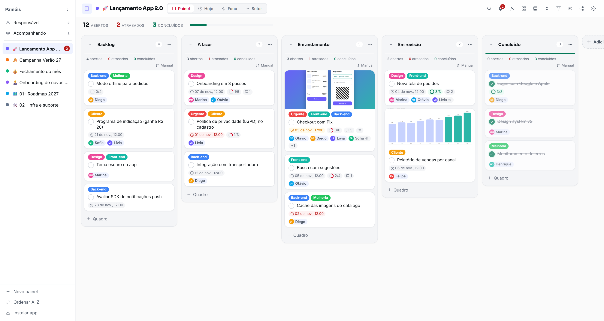

## Why it exists

Tasks in a growing company end up scattered across chats, e-mails and spreadsheets. Prisma gives every
team a board, lets anyone be marked on a single card without seeing the whole board, and keeps nudging
people (in the app and as desktop notifications) until things are done.

## Features

| Area | What you get |
| --- | --- |
| **Boards & lists** | Unlimited boards, colors, emoji and backgrounds; lists you can collapse, archive and send to a 15-day trash; drag cards between lists — even onto a collapsed one |
| **Per-list tools** | Counters (open · overdue · done), quick filters and sorting per list: manual, due date, completion date, newest or A–Z |
| **Cards** | Labels, due dates, recurring cards, checklists with progress, covers (image or color), Markdown description, linked tickets |
| **People** | *Owners* and *followers* on each card; `@mentions` in comments; being marked on a card grants access to **that card only** |
| **Attachments** | Images, PDFs, Office files (opened in an online viewer), links and HTML pages rendered in a sandboxed viewer; one-click download |
| **Activity** | Comments plus a full history of who changed what |
| **Views** | *Board*, *Today* (overdue / today / tomorrow / next 7 days), *Focus* (one ranked list of what to do next) and a *Department dashboard* |
| **My work** | Virtual boards "Owner" and "Following" that gather every card you are on, across all boards |
| **Notifications** | In-app bell plus desktop notifications for assignments, mentions, overdue and forgotten cards |
| **Personal sidebar** | Each person orders their boards by drag-and-drop (long-press on touch) or A–Z with natural numbers (`1, 2, 10`) |
| **Installable app** | A dedicated PWA with its own icon set (any / maskable / Apple touch) that opens straight into the boards |

<table>
  <tr>
    <td>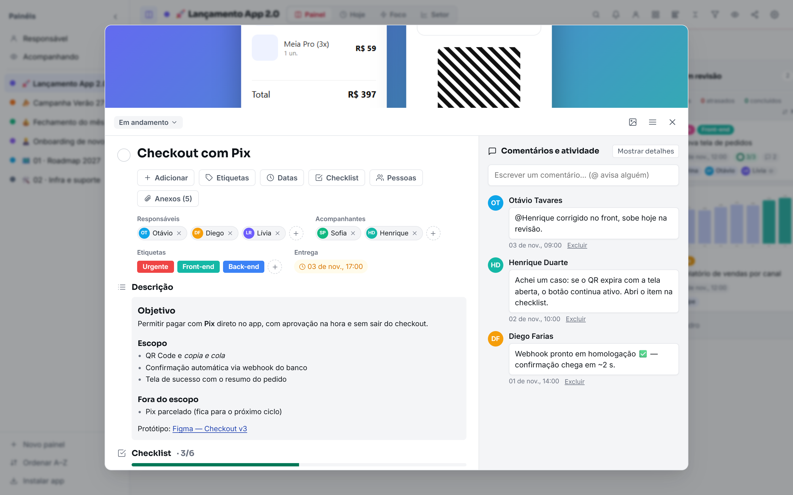</td>
    <td>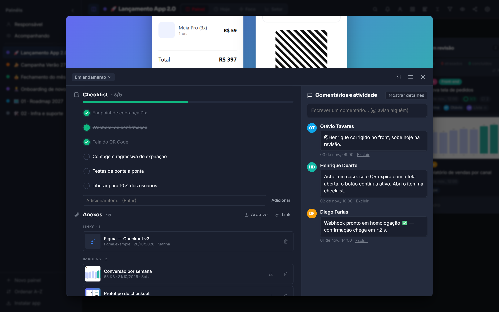</td>
  </tr>
  <tr>
    <td align="center">Card detail — owners, followers, labels, dates, description, comments</td>
    <td align="center">Checklist, attachments grouped by type, activity</td>
  </tr>
  <tr>
    <td>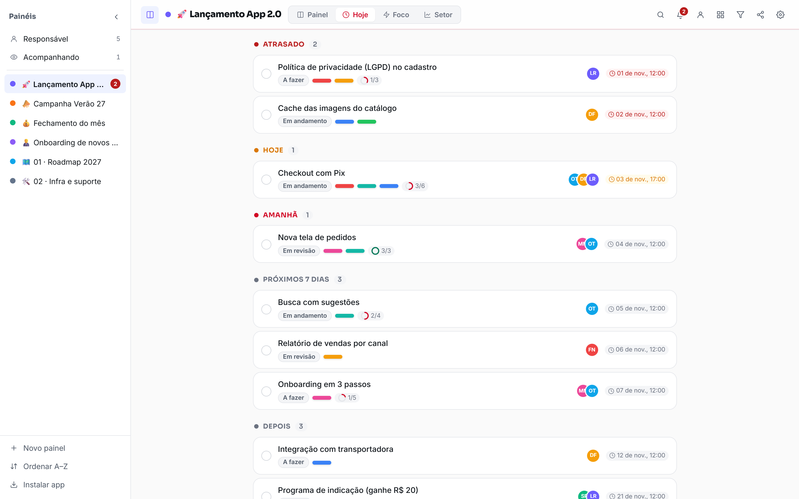</td>
    <td>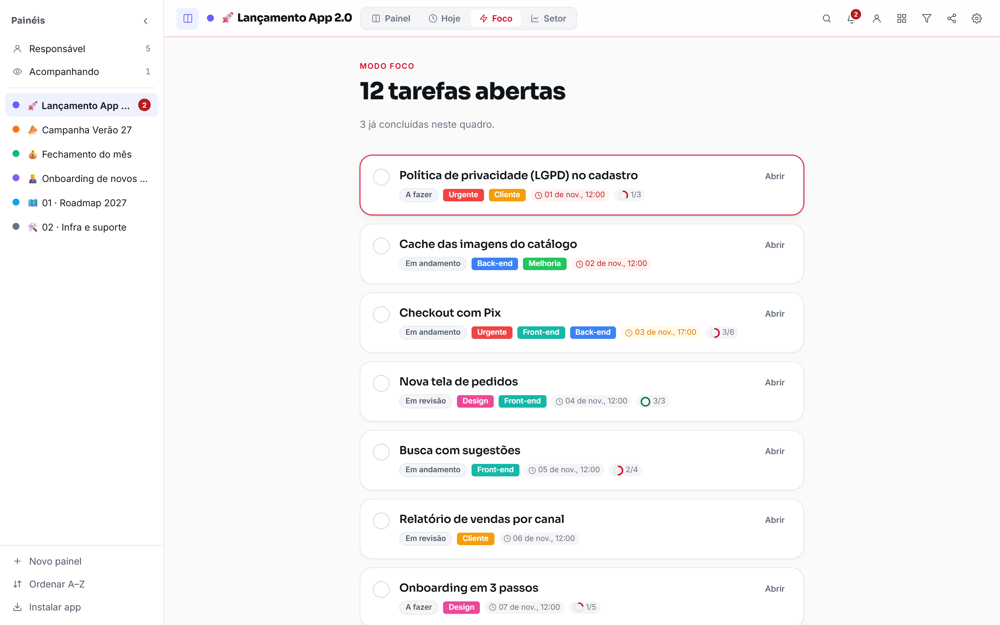</td>
  </tr>
  <tr>
    <td align="center"><i>Today</i> — what is late, due today, tomorrow and this week</td>
    <td align="center"><i>Focus</i> — a single ranked to-do list</td>
  </tr>
  <tr>
    <td>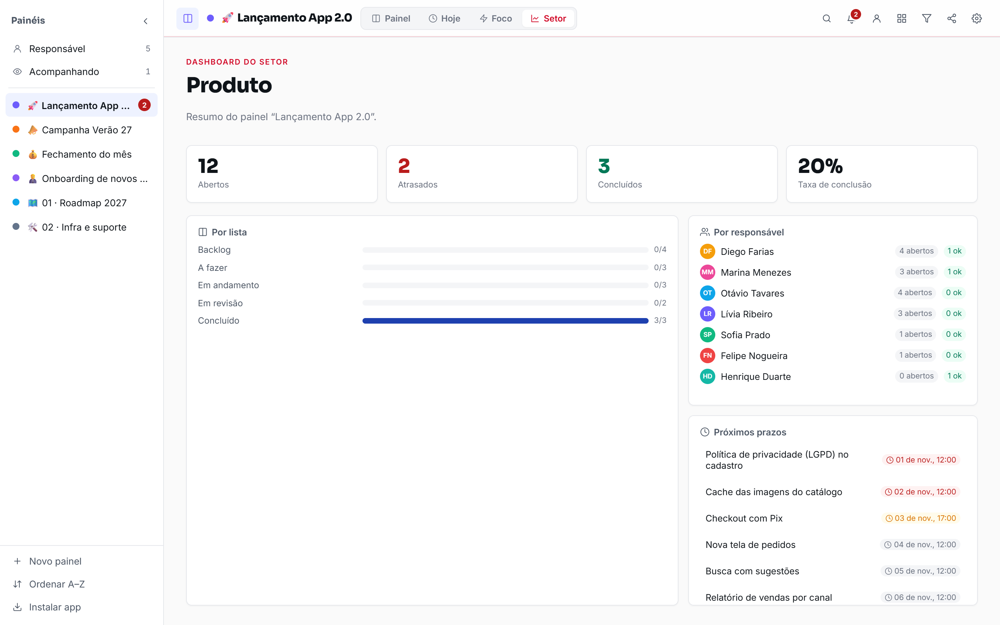</td>
    <td>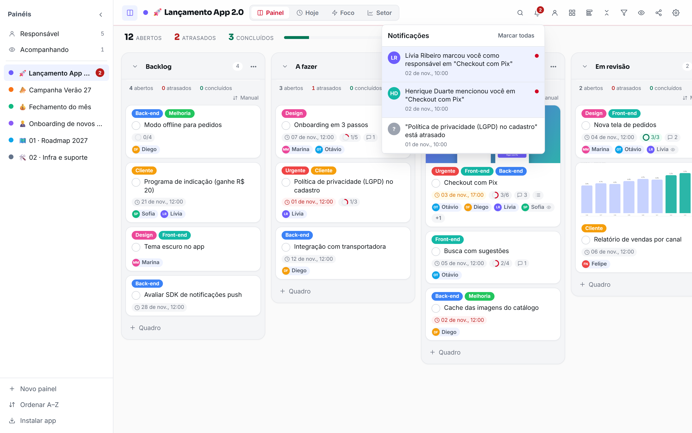</td>
  </tr>
  <tr>
    <td align="center">Department dashboard — per list, per person, next deadlines</td>
    <td align="center">Notifications</td>
  </tr>
  <tr>
    <td>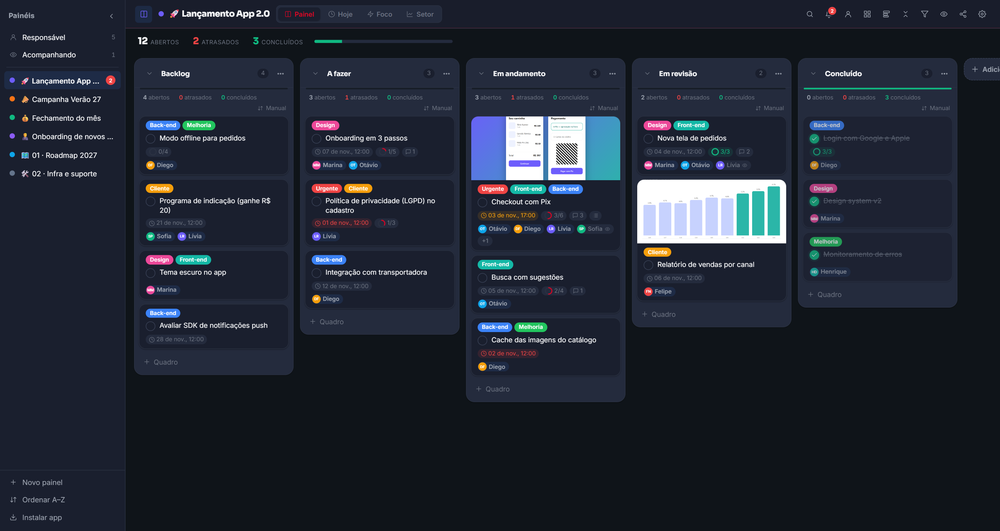</td>
    <td align="center">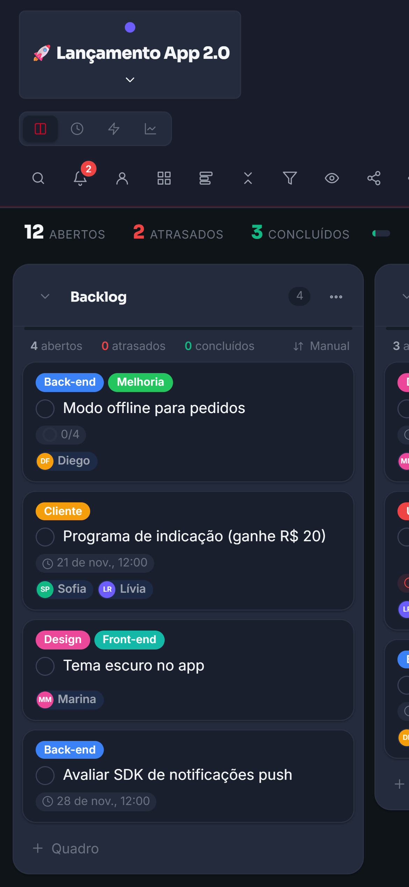 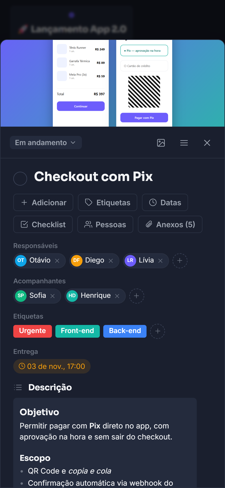</td>
  </tr>
  <tr>
    <td align="center">Dark theme</td>
    <td align="center">Installed app on a phone</td>
  </tr>
</table>

## Engineering highlights

- **Access rules in the database, not the UI.** Who sees a board is decided by Postgres **Row Level
  Security**: the owner, invited members (edit / comment / read) and department managers (read-only).
  Someone marked on a single card gets that card and nothing else. Only the owner can share.
- **Per-person preferences without per-person tables.** Board order is one `uuid[]` per user, written
  through a tiny `security invoker` RPC, so RLS still applies and the UI stays optimistic.
- **Drag-and-drop that works with a mouse and a thumb.** Pointer events, a small movement threshold for
  the mouse and a **long-press** for touch, so scrolling a list on a phone never reorders it by accident.
- **Safe rendering of user files.** HTML attachments are rendered in an `iframe` with `srcdoc` and a
  sandbox **without** `allow-same-origin`: the page runs, but can't read the user's session.
- **Robots that keep boards honest.** Background jobs mark overdue cards, warn about cards nobody touched
  in a while, create the next occurrence of recurring cards and push desktop notifications.
- **One build, two front doors.** The same SPA serves the portal route and a standalone app route; the
  HTML entry swaps the manifest, icons and title before the app boots, so each installs as its own app.
- **Migration from the old tool.** Boards, lists, cards, labels and comments were imported from the
  previous kanban, keeping the original ids to stay idempotent.

## Architecture

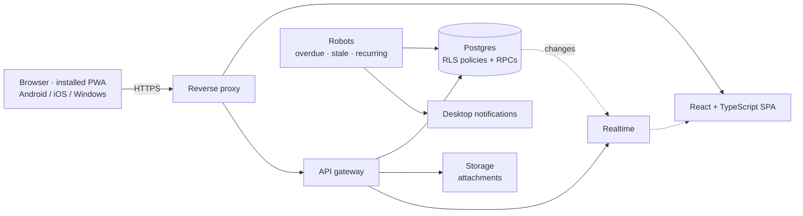

## Code samples (written for this showcase)

- [`snippets/board_access.sql`](snippets/board_access.sql) — visibility rules and a per-user board order with RLS
- [`snippets/use-long-press-reorder.ts`](snippets/use-long-press-reorder.ts) — reorder a vertical list with mouse drag or touch long-press
- [`snippets/sandboxed-html-viewer.tsx`](snippets/sandboxed-html-viewer.tsx) — show an uploaded HTML file without giving it your session
- [`snippets/natural-sort.ts`](snippets/natural-sort.ts) — A–Z that puts `2 · Ops` before `10 · Roadmap`

## Stack

React · TypeScript · Vite · Supabase (Postgres, Auth, Storage, Realtime) · Row Level Security ·
PWA (Web App Manifest, maskable icons) · Python/Node workers · Playwright for end-to-end checks

## Privacy note

The screenshots were taken from the real interface pointed at an in-browser mock API. Every board,
card, person, e-mail and image is fictitious ("Acme"). No production code, credentials or business
rules are included in this repository.
